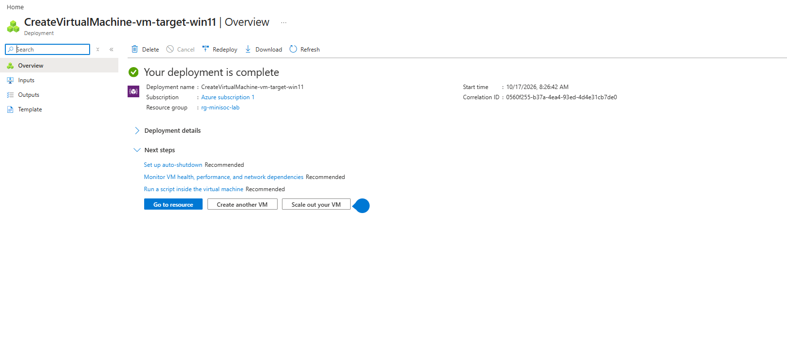
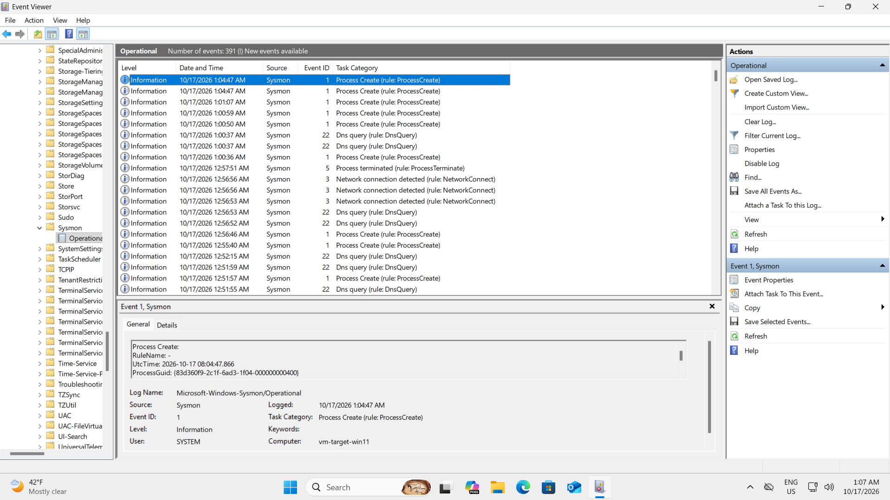
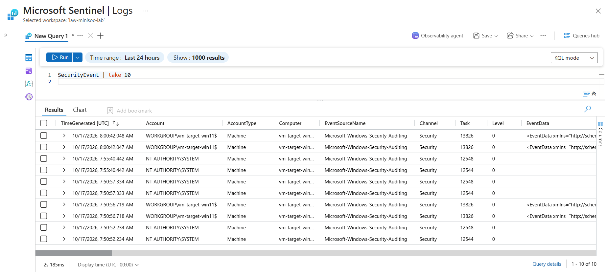
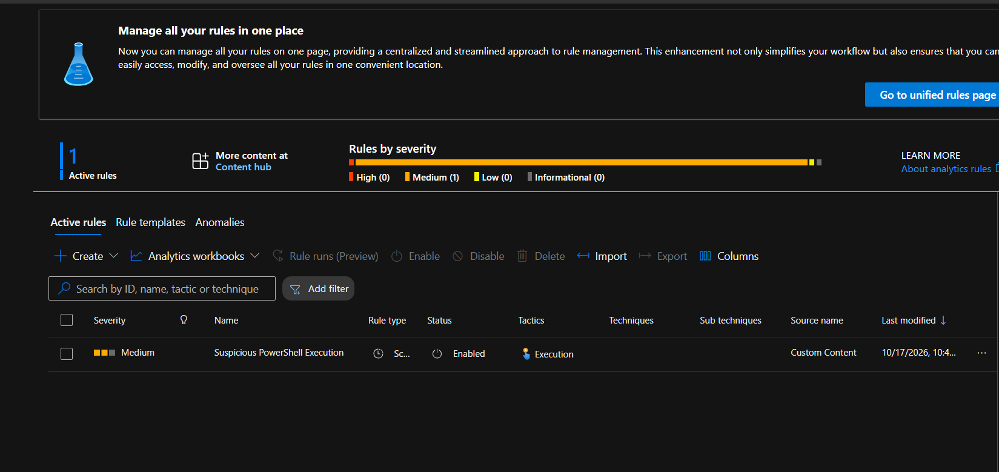
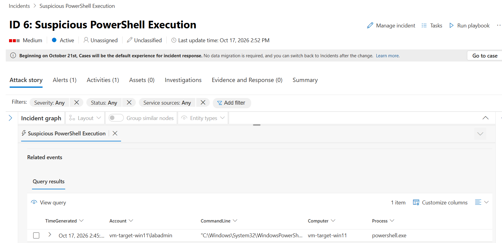
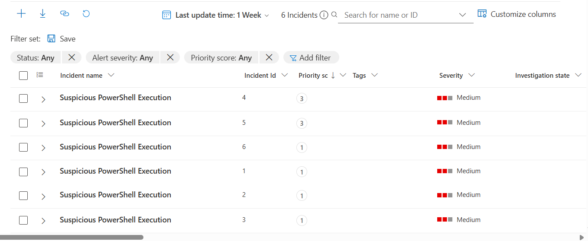
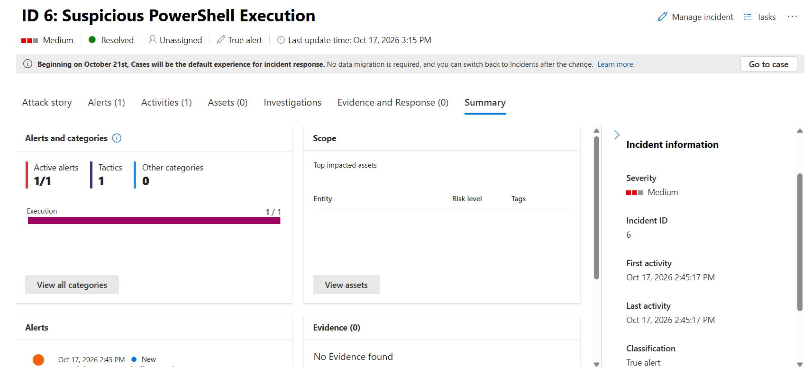

# microsoft-sentinel-mini-soc
Cloud SIEM setup using Microsoft Sentinel, Windows 11 VM, Sysmon, custom KQL detection rules, and incident investigation.

## 📝 Executive Summary
Engineered and deployed a cloud-native Security Information and Event Management (SIEM) lab using Microsoft Sentinel and an Azure Windows 11 Virtual Machine. The objective was to simulate a real-world Security Operations Center (SOC) workflow: deploying an endpoint, ingesting telemetry via Sysmon, authoring a custom KQL detection rule, simulating a malicious PowerShell attack, and conducting incident triage and response. This project demonstrates hands-on proficiency in cloud security architecture, detection engineering, and threat hunting.

## 🗺️ Architecture & Component Overview

**Data Flow:**
`[ Windows 11 VM (Sysmon) ]` ---> `[ Azure Monitor Agent (AMA) ]` ---> `[ Log Analytics Workspace ]` ---> `[ Microsoft Sentinel (SIEM) ]`

**How it works:**
1.  **Telemetry Generation:** Sysmon is installed on the Windows 11 VM to capture granular endpoint telemetry, specifically focusing on Process Creation events (Event ID 1) which log command-line arguments.
2.  **Ingestion:** The Azure Monitor Agent (AMA) collects these Sysmon event logs and streams them securely into a centralized Log Analytics Workspace.
3.  **Detection:** Microsoft Sentinel sits on top of the Log Analytics Workspace. A custom Scheduled Analytics Rule runs a KQL (Kusto Query Language) query every 5 minutes to detect suspicious PowerShell execution flags (e.g., `-ExecutionPolicy Bypass`, `Invoke-WebRequest`).
4.  **Alerting & Response:** When the rule matches the log data, Sentinel automatically generates an Incident. The SOC analyst then triages the incident, reviews the raw query results to identify the impacted host and user account, and formally closes the incident as a True Positive.

### 📸 Lab Evidence & Screenshots

*   **Azure VM Deployment:** 
*   **Sysmon Logs in Event Viewer:** 
*   **Sentinel KQL Log Ingestion:** 
*   **Enabled Custom Detection Rule:** 
*   **Incident Investigation (Query Results):** 
    *   *Note: The visual investigation graph did not map entities in this environment. The raw query results were used to verify the Host, Account, and CommandLine evidence.*
*   **Sentinel Incident Queue:** 
*   **Final Triage (Resolved Incident):** 

